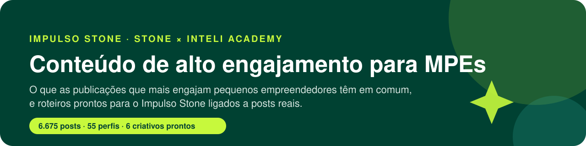
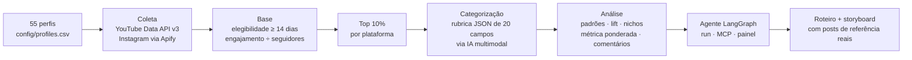

<p align="center"></p>

# Conteúdo de alto engajamento para MPEs · Impulso Stone

**Stone × Inteli Academy.** Mapeamento das publicações de maior engajamento voltadas a micro e pequenos empreendedores
(MPEs) e um agente de IA que transforma esses padrões em roteiros de vídeo para o **@impulsostone**, cada um ligado às
publicações reais em que se apoia.

| 6.675 publicações | 55 perfis | 625 no top 10% | 19.941 comentários | 6 criativos prontos |
|:---:|:---:|:---:|:---:|:---:|
| Instagram + YouTube Shorts | 7 nichos, micro a grande | por plataforma | só contagens, sem autores | ligados a posts reais |

> **Para quem vai avaliar:** comece pelo [Relatório executivo](docs/RELATORIO_EXECUTIVO.md) e abra o painel em
> [3 comandos](#como-rodar). Todos os padrões são observados nos dados, não garantia de resultado.

---

## Principais achados

| Achado | Evidência |
|---|---|
| **Gancho de curiosidade** é o sinal mais forte do alto desempenho | 48% do top vs 24% do resto (**2,0×**), em 25 criadores; estável na métrica ponderada |
| Quem aparece é **empreendedor real, de rosto, em tom informal** | 84% · 76% · 73% do top; padrão na maioria dos criadores |
| **Texto na tela** é quase regra | 65% do top no YouTube, 82% no Instagram |
| **Humor/esquete** e **vídeos de 15–30 s** se destacam | 2,7× e 2,2× mais frequentes no top |
| **Comentários pedem resposta** | 17% são dúvidas; 4,5% mostram intenção de contato |
| A **maioria dos criadores do top usa CTA** | 59% por criador, sobretudo "link na bio" |

Detalhes, nichos e tabelas: [docs/RESULTADOS.md](docs/RESULTADOS.md).

## Entregas

| Entrega | Onde |
|---|---|
| Relatório executivo com recomendações para o @impulsostone | [docs/RELATORIO_EXECUTIVO.md](docs/RELATORIO_EXECUTIVO.md) |
| Playbook: padrões, perfis em destaque e **6 criativos** com gancho, storyboard, legenda, CTA e posts de referência | [outputs/playbook.md](outputs/playbook.md) |
| Painel interativo: roteiro com storyboard ilustrado, nichos, padrões e métrica ponderada | `streamlit run demo/app.py` |
| Agente: função `run()` e servidor MCP (analisar, recomendar, gerar criativo) | [docs/GUIA_DE_USO.md](docs/GUIA_DE_USO.md#3-usar-o-agente) |
| Base pública sanitizada, com dicionário de dados e checksums | [data/release/](data/release/README.md) |
| Metodologia, desempenho dos modelos, privacidade e segurança | [docs/](docs) |
| Roteiro do vídeo de entrega (2 min) | [docs/ROTEIRO_VIDEO_2MIN.md](docs/ROTEIRO_VIDEO_2MIN.md) |

## Como rodar

Requisitos: Python 3.11+ e Git. Não precisa de chave de API para ver o projeto funcionando.

```bash
git clone https://github.com/Henriquerssx/Case-Stone.git && cd Case-Stone
python -m venv .venv && .venv/Scripts/activate        # macOS/Linux: source .venv/bin/activate
pip install -r requirements.lock.txt && pip install -e . --no-deps
streamlit run demo/app.py                             # monta a base pública e abre http://localhost:8501
```

Na aba **Gerar roteiro**, deixe **Modo offline** ligado e clique em **Gerar**. Coleta, categorização e geração ao vivo
exigem chaves no `.env` (modelo em `.env.example`): ver [Guia de uso](docs/GUIA_DE_USO.md).

```bash
pytest                                                # 64 testes, base sintética, sem chamadas externas
```

## Como funciona



- **Métrica oficial:** `(curtidas + comentários) ÷ seguidores`; alto desempenho = top 10% da plataforma
  (Instagram ≥ 2,00%, YouTube ≥ 1,29%).
- **Métrica ponderada (IDP):** compara cada post com o mesmo nicho (35%), o normal do próprio criador (30%), a mesma
  época (20%) e o mesmo porte de conta (15%). Reduz a concentração do top em poucos canais (66% → 51% no YouTube) e
  confirma que os padrões se mantêm. Pesos ajustáveis no painel.
- **Rastreabilidade:** números e links saem de consultas à base; a IA só redige. Toda referência citada é validada
  contra a base: 75 de 75 execuções do agente rastreáveis.
- **Resiliência:** cadeia de 7 modelos gratuitos com fallback, pausa de modelos indisponíveis, retomada automática e
  modo offline. Custo de inferência: zero.

**Identidade visual:** o painel e o storyboard usam as cores públicas do Impulso Stone (verde Sherwood `#004132`,
verde-limão `#C7F93C`, roxo `#A780FF`) e do Clube dos Sonhos (tinta `#03211D`, verde-água `#32ADA1`), com Manrope e
Outfit. Tema claro e escuro em `.streamlit/config.toml`; as paletas dos gráficos foram validadas para contraste e daltonismo.

Detalhes em [docs/METODOLOGIA.md](docs/METODOLOGIA.md) e [docs/DESEMPENHO_DOS_MODELOS.md](docs/DESEMPENHO_DOS_MODELOS.md).

## Confiabilidade

| Verificação | Resultado |
|---|---|
| Rubrica estável entre dois modelos diferentes (campos objetivos) | 96–98% de concordância (kappa 0,93–0,96) |
| Rubrica estável entre modelos (tema, gancho, formato) | 69–76%: lidos como tendência |
| Padrões resistem ao controle de nicho, perfil, época e porte | sim: gancho de curiosidade 48% → 48% |
| Validação humana às cegas | 50 posts sorteados, ferramenta de rotulagem em `demo/rotular.py` |

## Estrutura

```
src/stone_mpe/
  collect/        coleta (YouTube, Apify), HTTP com cache e retry, importador do Instagram
  process/        normalização, elegibilidade, métrica e ranking
  multimodal/     rubrica (Pydantic) e categorização com IA
  analysis/       padrões, lift, nichos, métrica ponderada, comentários, concordância
  agent/          grafo LangGraph, ferramentas, prompts e contrato
  api.py · mcp_server.py · cli.py · playbook.py · storyboard.py · release.py
demo/             painel (app.py) e tela de rotulagem manual (rotular.py)
data/release/     base pública sanitizada + MANIFEST.json
outputs/          playbook, tabelas de padrões, métrica ponderada, concordância
docs/             relatório, metodologia, resultados, modelos, guia, privacidade, roteiro do vídeo
tests/            64 testes (base sintética)
```

## Dados, privacidade e segurança

O repositório é público e **não** contém legendas, capas, texto de comentários, dados de quem comenta, logs de execução
nem chaves de API. Só métricas públicas agregadas, links e a categorização. A coleta do Instagram usou o Apify (rota
definida no kickoff), em tensão com o TAP §4.3, o que está declarado. O código passou por auditoria de segurança antes
da publicação. Ver [docs/DADOS_PRIVACIDADE_E_SEGURANCA.md](docs/DADOS_PRIVACIDADE_E_SEGURANCA.md) e [SECURITY.md](SECURITY.md).

## Limitações

- Correlação, não causalidade; lead é indicador indireto (CTA e intenção nos comentários).
- Seguidores medidos na data da coleta (23–24/11/2026); impulsionamento pago não é visível.
- Instagram com 17 perfis: poucos por nicho. O nível de coleta usado não traz views nem duração do Instagram.
- A categorização de Nível 1 usa legenda e capa; gancho falado e ritmo de cortes ficam para o Nível 2.
- Cotas gratuitas dos modelos mudam sem aviso: o modo offline garante a demonstração.

## Próximos passos

Publicar e medir os 6 criativos com os Insights do @impulsostone · migrar o Instagram para a API oficial com contas
parceiras · Nível 2 (frames e transcrição) no top · atualização trimestral da base.

---

Projeto acadêmico desenvolvido no programa Stone × Inteli Academy (2026). Os dados de terceiros pertencem aos seus
autores e são citados por link.
